# Fluxary

**Gestão financeira pessoal de forma simples, inteligente e organizada.**

<sub>**Projeto em desenvolvimento** 🚧</sub>

Fluxary é uma aplicação web de gestão financeira pessoal desenvolvida com o objetivo de tornar o controle do dinheiro mais acessível, intuitivo e organizado.

A plataforma reúne ferramentas para acompanhar receitas e despesas, administrar contas bancárias, controlar cartões de crédito, estabelecer metas financeiras e planejar gastos mensais. Também conta com um assistente financeiro integrado com inteligência artificial, pensado para ajudar os usuários a compreender seus hábitos de consumo e tomar decisões financeiras mais conscientes.

O projeto está sendo desenvolvido com foco em usabilidade, segurança, organização do código e experiência do usuário.

---

## Demonstração visual

### Visão geral e acesso

<table>
<tr>
<td width="50%"></td>
<td width="50%">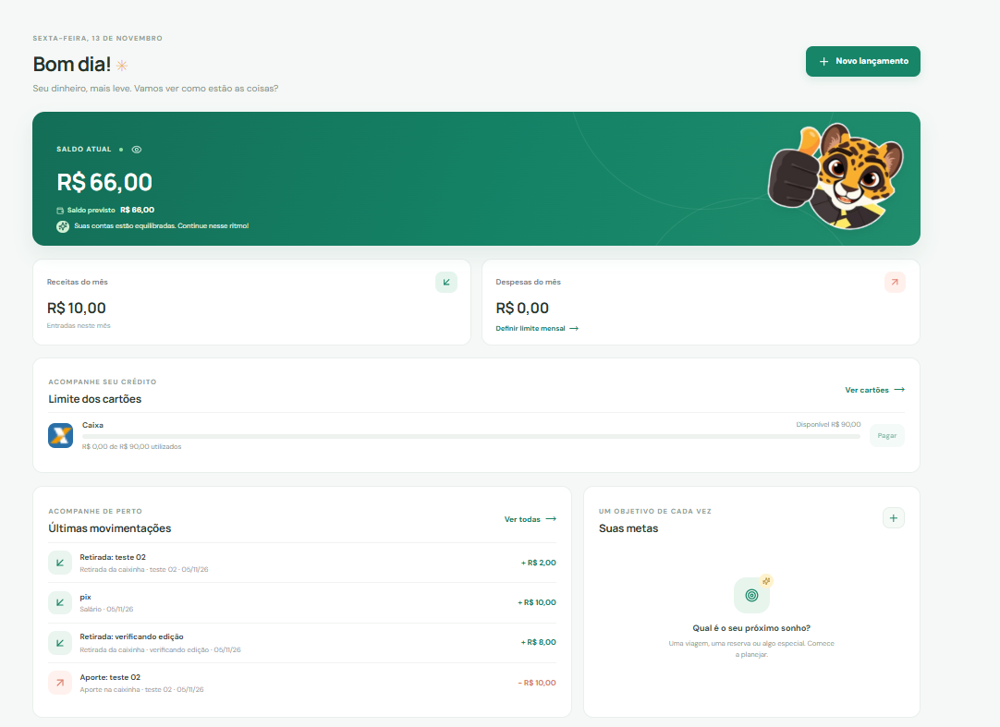</td>
</tr>
<tr>
<td>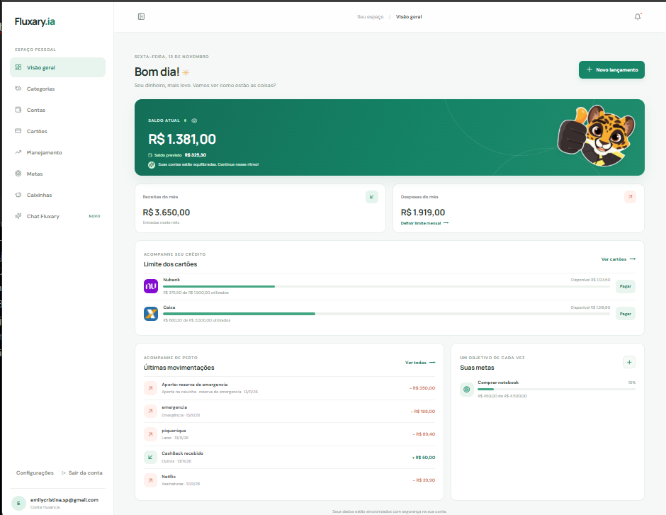</td>
<td>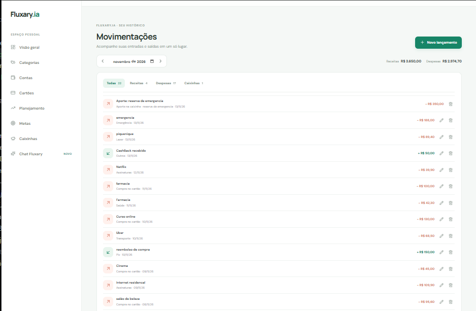</td>
</tr>
</table>

### Gestão financeira

<table>
<tr>
<td width="50%">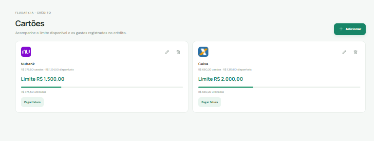</td>
<td width="50%">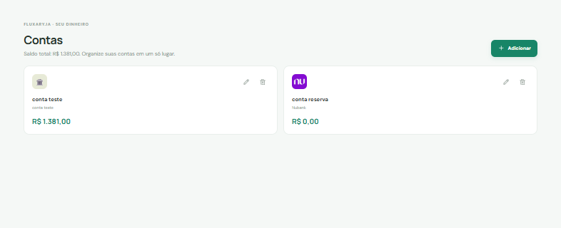</td>
</tr>
<tr>
<td>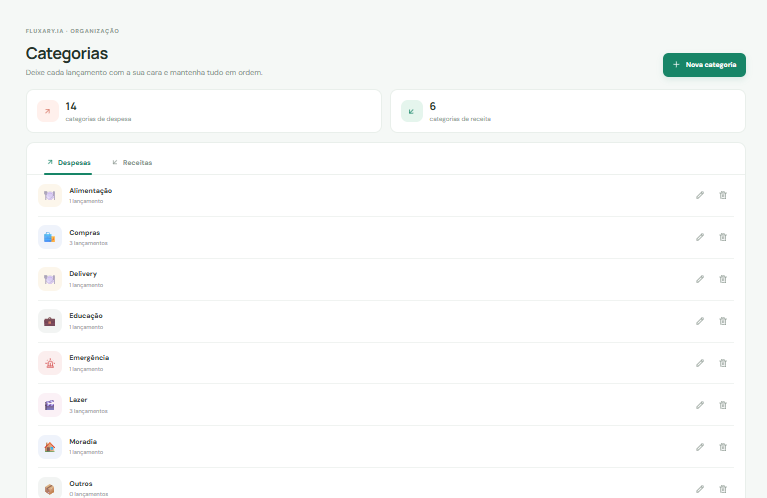</td>
<td>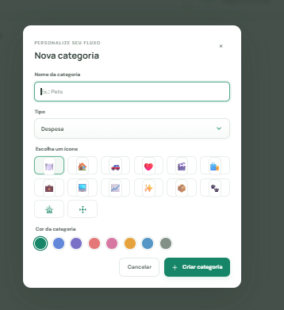</td>
</tr>
</table>

### Cadastro e planejamento financeiro

<table>
<tr>
<td width="50%">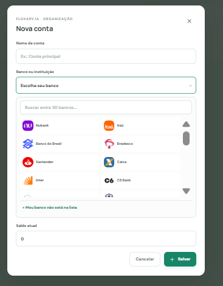</td>
<td width="50%">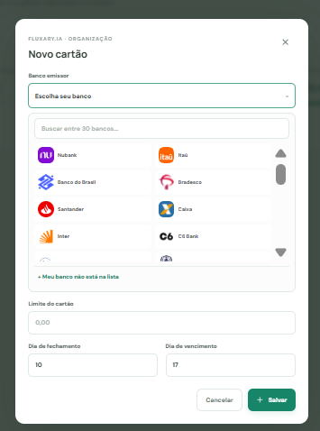</td>
</tr>
<tr>
<td>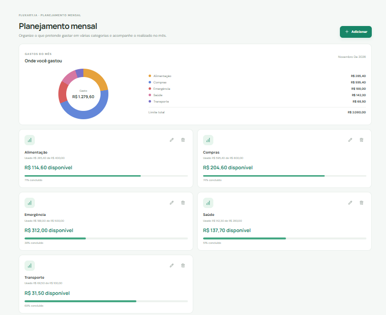</td>
<td>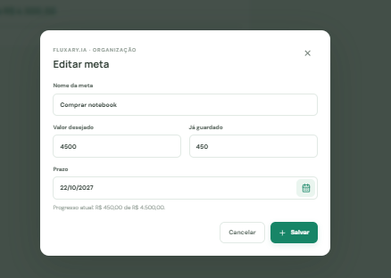</td>
</tr>
</table>

### Felix — Assistente financeiro com IA

<table>
<tr>
<td width="50%">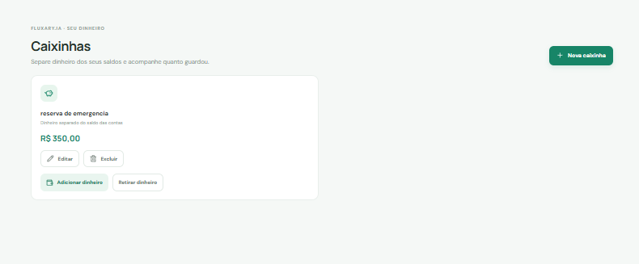</td>
<td width="50%"></td>
</tr>
<tr>
<td>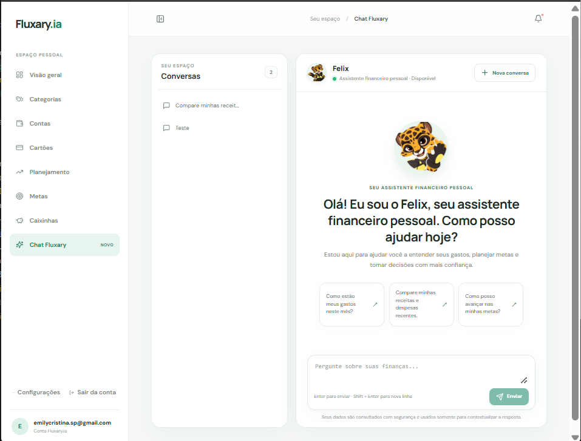</td>
<td>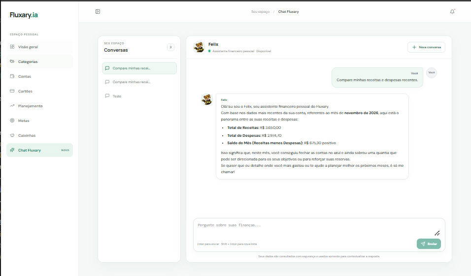</td>
</tr>
</table>

### Configurações

<p align="center">
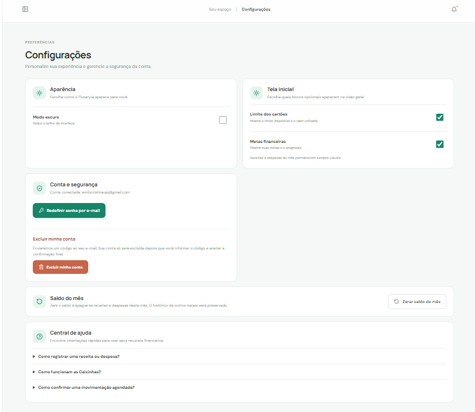
</p>

---

## Funcionalidades desenvolvidas

As funcionalidades abaixo já possuem implementação no projeto, embora algumas ainda estejam passando por validações e aprimoramentos.

- **Autenticação de usuários:** cadastro, login, recuperação de senha e confirmação de e-mail.
- **Login com Google:** autenticação por provedor externo.
- **Dashboard financeiro:** visualização geral das informações financeiras.
- **Contas bancárias:** cadastro, gerenciamento e organização de contas.
- **Movimentações:** registro e acompanhamento de receitas e despesas.
- **Categorias financeiras:** organização das movimentações por categorias.
- **Cartões de crédito:** gerenciamento de cartões e estrutura de compras e parcelas.
- **Planejamento mensal:** definição de limites de gastos por categoria.
- **Metas financeiras:** criação e acompanhamento de objetivos.
- **Caixinhas de economia:** organização de valores reservados e histórico de movimentações.
- **Assistente financeiro com IA:** chat para interação e análise de questões relacionadas às finanças.
- **Configurações:** gerenciamento de preferências da conta.
- **Exclusão de conta:** implementação de fluxo de solicitação e preservação de histórico financeiro.

## Tecnologias utilizadas

| Tecnologia | Aplicação no projeto |
|---|---|
| React | Construção da interface |
| TypeScript | Tipagem e organização do código |
| Vite | Ambiente de desenvolvimento e build |
| HTML5 | Estrutura da aplicação |
| CSS3 | Estilização e responsividade |
| Python | Desenvolvimento dos serviços de backend |
| Supabase | Backend, autenticação e integração com banco de dados |
| PostgreSQL | Banco de dados relacional |
| Git e GitHub | Versionamento e controle do código |
| Vercel | Plataforma de publicação da aplicação |
| Inteligência Artificial | Assistente financeiro integrado |

## Arquitetura e organização

O projeto possui uma estrutura dividida entre frontend, backend, banco de dados e testes, buscando manter a organização e facilitar a manutenção e evolução da aplicação.

```text
fluxary/
│
├── api/
│   ├── account_deletion.py
│   ├── ai_provider.py
│   ├── chat.py
│   └── delete_account.py
│
├── public/
│   ├── mascotes/
│   ├── 01-visao-geral-inicial.png
│   ├── 02-visao-geral-com-dados.png
│   ├── 03-movimentacoes.png
│   ├── 04-cartoes-de-credito.png
│   ├── 05-contas-bancarias.png
│   ├── 06-categorias-financeiras.png
│   ├── 07-criar-categoria.png
│   ├── 08-criar-conta.png
│   ├── 09-criar-cartao.png
│   ├── 10-planejamento-mensal.png
│   ├── 11-editar-meta-financeira.png
│   ├── 12-caixinhas-de-economia.png
│   ├── 13-chat-felix-tela-inicial.png
│   ├── 14-chat-felix-pagina-completa.png
│   ├── 15-chat-felix-resposta-financeira.png
│   ├── 16-configuracoes.png
│   ├── login-artwork.svg
│   └── tela-de-login.png
│
├── src/
│   ├── components/
│   ├── css/
│   │   ├── pages/
│   │   ├── shared/
│   │   └── index.css
│   ├── data/
│   │   ├── banks.ts
│   │   └── categories.ts
│   ├── hooks/
│   │   └── useFinanceData.ts
│   ├── lib/
│   │   ├── auth-storage.ts
│   │   ├── auth-tab.ts
│   │   ├── database.types.ts
│   │   └── supabase.ts
│   ├── pages/
│   ├── services/
│   │   ├── accounts.ts
│   │   ├── accountDeletion.ts
│   │   └── chat.ts
│   ├── types/
│   │   └── finance.ts
│   ├── utils/
│   ├── App.tsx
│   ├── main.tsx
│   └── vite-env.d.ts
│
├── supabase/
│   └── migrations/
│
├── tests/
│   ├── auth-page.test.tsx
│   ├── auth-provider.test.tsx
│   ├── auth-storage.test.ts
│   ├── auth-tab.test.ts
│   ├── cash-boxes.test.tsx
│   ├── chat-page.test.tsx
│   ├── errors.test.ts
│   ├── finance.test.ts
│   ├── planning.test.tsx
│   ├── settings-page.test.tsx
│   ├── supabase-session.test.ts
│   ├── test_ai_provider.py
│   ├── test_chat_api.py
│   ├── test_delete_account.py
│   ├── transaction-details.test.tsx
│   └── use-finance-data.test.ts
│
├── .env.example
├── .gitignore
├── BANCO_DE_DADOS_COMPLETO.sql
├── TESTES_BANCO_DE_DADOS.sql
├── index.html
├── package.json
├── package-lock.json
├── requirements.txt
├── README.md
├── tsconfig.json
└── vite.config.ts
```

*Observação: a estrutura acima representa a organização atual do projeto em suas principais pastas e arquivos. Alguns diretórios possuem arquivos adicionais.*

## Banco de dados e segurança

O Fluxary utiliza Supabase com PostgreSQL para armazenar e gerenciar os dados da aplicação.

A estrutura do banco contempla entidades como:

- Perfis e configurações de usuários.
- Contas bancárias.
- Transações financeiras.
- Categorias.
- Cartões de crédito e compras parceladas.
- Planejamentos e limites mensais.
- Metas financeiras.
- Caixinhas de economia e depósitos.
- Conversas e mensagens do assistente com IA.
- Eventos de utilização da IA.
- Solicitações de exclusão de contas.

### Segurança implementada

- Row Level Security (RLS) nas tabelas que armazenam dados dos usuários.
- Políticas de acesso baseadas na identificação do usuário autenticado.
- Separação dos dados entre diferentes usuários.
- Controle de utilização do assistente com IA.
- Gerenciamento de sessões e sincronização de autenticação entre abas.
- Operações específicas para preservação do histórico financeiro durante determinadas exclusões.

A segurança do banco e as regras de acesso estão sendo continuamente verificadas.

## Testes e validações

O projeto possui uma estrutura de testes automatizados para validar diferentes partes da aplicação.

Entre as áreas contempladas estão:

- Autenticação e gerenciamento de sessões.
- Login e provedores de autenticação.
- Armazenamento e sincronização entre abas.
- Movimentações financeiras.
- Gerenciamento de contas.
- Planejamento mensal.
- Caixinhas de economia.
- Assistente financeiro.
- Configurações.
- Exclusão de conta.
- Integração com Supabase.

São utilizados testes com arquivos TypeScript/TSX e Python, incluindo validações de funcionalidades do frontend e dos serviços de backend.

A suíte de testes e as validações de integração continuam em evolução.

---

## Próximas etapas

O Fluxary ainda está em desenvolvimento. As próximas etapas incluem:

- [ ] Finalizar a auditoria e validação geral do banco de dados.
- [ ] Realizar testes integrados de todas as funcionalidades.
- [ ] Aprimorar a responsividade em diferentes dispositivos.
- [ ] Revisar e aperfeiçoar a experiência de uso.
- [ ] Finalizar o fluxo de exclusão de conta com confirmação por e-mail.
- [ ] Configurar o domínio próprio e o remetente personalizado de e-mail.
- [ ] Realizar testes completos de publicação e produção.
- [ ] Aprimorar o assistente financeiro e suas capacidades de análise.
- [ ] Revisar a segurança e o tratamento de erros.
- [ ] Publicar a versão estável da aplicação.

Novas funcionalidades e melhorias poderão ser adicionadas durante o desenvolvimento.

## Executar localmente

### Pré-requisitos

- Node.js e npm.
- Python.
- Conta e projeto Supabase.
- Variáveis de ambiente necessárias para a aplicação.

### Instalação

Clone o repositório:

```bash
git clone https://github.com/Lymm-08/FluxaryIA.git
```

Entre na pasta:

```bash
cd FluxaryIA
```

Instale as dependências do frontend:

```bash
npm install
```

Instale as dependências do backend:

```bash
pip install -r requirements.txt
```

Configure as variáveis de ambiente utilizando o arquivo `.env.example` como referência.

Inicie o ambiente de desenvolvimento do frontend:

```bash
npm run dev
```

*Os serviços Python devem ser executados conforme a configuração de backend do projeto.*

## Status do projeto

<sub>Em desenvolvimento ativo — Novembro de 2026.</sub>

O Fluxary é um projeto autoral em construção, no qual estão sendo aplicados conhecimentos de desenvolvimento frontend e backend, integração com banco de dados, autenticação, segurança, testes automatizados, versionamento e integração de inteligência artificial.

O objetivo é evoluir a aplicação até uma versão estável, segura e disponível para utilização em diferentes dispositivos.

---

**Desenvolvido por [Lymm-08](https://github.com/Lymm-08).**
